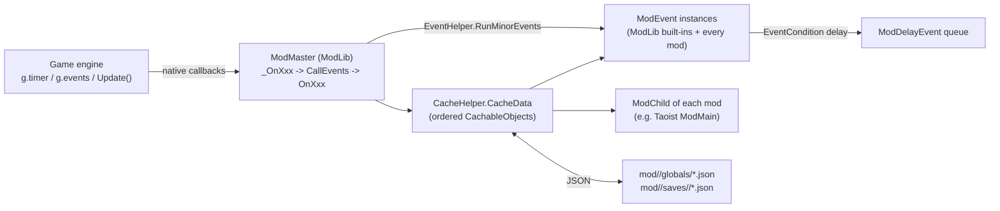
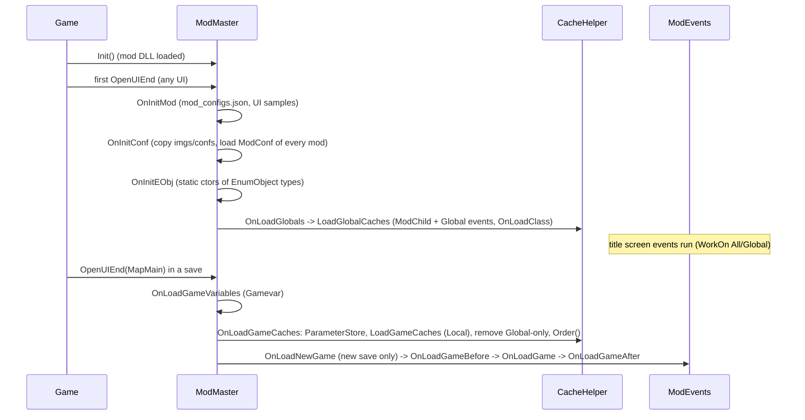

# ModLib - Architecture

ModLib (Workshop `3385996759`, mod id `flQrxq`, namespace `ModLib` + `MOD_flQrxq`) is a framework that sits between the game (Unity Il2Cpp + MelonLoader/Harmony) and content mods such as Taoist. It turns the game's native timers and events into a single, ordered, persisted event model.

Related docs: [01-Event-Reference](01-Event-Reference.md) · [02-Cache-Persistence](02-Cache-Persistence.md) · [03-Builtin-Events](03-Builtin-Events.md) · [04-UI-Framework](04-UI-Framework.md) · [05-Attributes-Objects](05-Attributes-Objects.md) · [05-Helpers (main repository)](https://github.com/4azuo/GuiGuBaHuang-Taoist/blob/main/docs/05-Helpers.md)

## Source layout

| Folder (`ModLib/`: the C# project `ModLib/ModLib.csproj` of this repository; `ModMain/`: `3385996759/ModProject/ModCode/` of this repository) | Content |
|---|---|
| `ModMain/ModMain.cs` | `MOD_flQrxq.ModMain : ModMaster` - the concrete core object (name, id, version) |
| `ModLib/Mod/Base/` | `ModMaster` (partial: `ModMaster.cs`, `_GameEvent`, `_CommonEvent`, `_BattleEvent`, `_MapEvent`, `_TimerEvent`), `ModEvent`, `ModChild`, `ModSkill`, marker bases `BattleEvent`, `SkillEvent` |
| `ModLib/Mod/` | Built-in events: `ModDelayEvent`, `ModUIEvent`, `ModSkillEvent`, `ModTitleEvent`, `ModBattleEvent` |
| `ModLib/Object/` | `CachableObject`, `EnumObject`, `Gamevar`, `ParameterStore`, `ModConfigs`, `MultiValue`, `DelayInfo`, `MonoUpdater`, `UI/*` |
| `ModLib/Helper/` | Extension/helper classes (units, items, configs, cache, UI, debug...) - see [05-Helpers](https://github.com/4azuo/GuiGuBaHuang-Taoist/blob/main/docs/05-Helpers.md) |
| `ModLib/Attribute/` | `Cache`, `ModOrder`, `EventCondition`, `ErrorIgnore`, `Skill`, `EventCat`/`ActionCat` (+ `Ign`) |
| `ModLib/Enum/` | `EnumObject` based enums (`UnitPropertyEnum`, `UnitDynPropertyEnum`, `GradePhaseEnum`...) and plain enums |
| `ModLib/Converter/` | `EnumObjectConverter` (Json.NET) |

## Runtime objects

* **ModMaster** - one per game process. `Init()` patches Harmony, registers 5 timers (10/100/200/500/1000 ms), the map/game/battle events (`EMapType`, `EGameType`, `EBattleType`) and a `MonoUpdater` (per-frame `OnMonoUpdate`).
* **CachableObject** - anything ModLib creates by reflection and persists as JSON: every `ModChild` and `ModEvent` declared with `[Cache("id")]` in ModLib and in all loaded mods.
* **ModChild** - exactly one per mod (CacheId = mod id). Created first (order -1, Global, WorkOn All).
* **ModEvent** - feature classes; override `OnXxx` methods. Execution order = `OrderIndex` (from `[Cache]` or the mod's `[ModOrder]` file).

## Two-layer dispatch

1. Native callback `ModMaster._OnXxx(ETypeData e)` (registered in `Init`) calls `CallEvents<T>("OnXxx", e)`: reflection call of `ModMaster.OnXxx` (its `MethodInfo` found once per name), casting the Il2Cpp event data to the concrete type `T`, measuring time (`DebugMode >= Finest`) and logging exceptions.
2. `ModMaster.OnXxx` does framework work when needed (load sequence, save, monthly tick...) and then calls `EventHelper.RunMinorEvents("OnXxx", e)`, which iterates the cached `ModEvent`s **that declare** the method, in cache order, and for each:

   The handlers of a method name (event, `MethodInfo`, `[EventCondition]`, `[ErrorIgnore]`, a delegate calling the method) are found **once** and kept until `CacheHelper.Version` changes (an object added or removed, caches cleared, re-ordered). Before 2.2.36 the lookup (reflection on every loaded object) ran at every call, i.e. once for every unit of `OnMonthlyForEachWUnit`. An exception thrown by a handler is the handler's own (no `TargetInvocationException`), so `[ErrorIgnore]` on the method that threw applies.
   * checks `[EventCondition(IsInGame, IsInBattle)]`,
   * defers through `ModDelayEvent` when `DelayMsec > 0`,
   * invokes the method and logs exceptions (with the in-game dialog in debug mode; `[ErrorIgnore]`: logged once per distinct error, no dialog).

`WorkOn` filtering is done by the cache itself: Global-only objects are removed when a save is loaded (`CacheHelper.RemoveUnuseGlobalCaches`), Local objects only exist inside a save.

## Load sequence

`OnLoadClass(isNew, modId, attr)` runs right after an object is created (`isNew = true`) or deserialized from its cache file; returning `false` from `OnCacheHandler()` skips the object entirely (used for features switched off by configuration).

## Monthly tick and save

`_OnWorldRunEnd` (end of each world step) detects a month change through `Gamevar.CurMonth` and then:

1. `RefreshParameterStore()` - snapshot of units (with a valid area), buildings, towns, schools; ModChild overrides cleared.
2. `OnRefreshParameterStoreOnMonthly` - mods can narrow the snapshot (`ModChild.SetParameterStore`, e.g. Taoist `PrepareEvent`).
3. `OnFirstMonth` (once per save), `OnMonthly`, `OnMonthlyForEachWUnit(wunit)` for every unit of the store (`EventHelper.RunMinorEventsForEachWUnit`: unit by unit, then handler by handler; since 2.2.36 the handlers of a mod whose ModChild set its own `ParameterStore` this month get only the units of that store, e.g. Taoist "All functions apply to nearest units"), `OnYearly` when a year boundary (month multiple of 12) was crossed.
4. `OnWorldRunEnd`, then `GameHelper.SaveGame()` (skipped while `ModMaster.NoSaveOnWorldRunEnd`).

One dispatch can stand for several months: when the calendar moved N months since the previous dispatch (a time skip advancing months without dispatching them), `ModMaster.MonthsPassed` = N and `ModMaster.YearsPassed` = the year boundaries crossed (1 / 0 in normal play; formulas in `TimeScaleHelper`). Handlers scale by them:

- amounts (interest, fees, taxes, wages, income, exp): x `MonthsPassed` (yearly ones x `YearsPassed`);
- monthly chances: `ModMaster.ChanceOver(chance, MonthsPassed)` = the chance of at least one over N months;
- "every P months" handlers (`GetGameTotalMonth() % P == 0`): `ModMaster.Ticks(P)` = the multiples of P passed (0, 1 or more).

`OnSave` (game save) dispatches to events, then writes `Gamevar`, all caches (`CacheHelper.Save`) and the log (`DebugHelper.Save`).

## Logs and files

* Logs: `%USERPROFILE%\AppData\LocalLow\guigugame\guigubahuang\mod\flQrxq\debug-YYYYMMDD.log` and `<playerId>_debug-YYYYMMDD.log` (see [06-Debug](https://github.com/4azuo/GuiGuBaHuang-Taoist/blob/main/docs/06-Debug.md)).
* Cache files: `mod\<modId>\globals\<CacheId>.json` (Global) and `mod\<modId>\saves\<playerId>\<CacheId>.json` (Local); skills in the skill cache folder.
* `ModConf/mod_configs.json` of ModLib: `{ "DebugMode": "Info" }` (`Info`, `Fine` = log each event start and a monthly profile, `Finest` = also the duration of each call).
* **Monthly profile** (`DebugMode` `Fine` or `Finest`): after each month the log gets `【Profile】month <year>/<month>`: the time of each phase of the month (`month:RefreshParameterStore`, `month:OnMonthly`, `month:OnMonthlyForEachWUnit (<n> units)`, `month:OnYearly`, `month:OnWorldRunEnd + save`), then the 20 slowest handlers since the previous report with calls, total and average (`EventHelper.WriteProfile`; also `AddProfile` / `TakeProfile`). The per-unit handlers (`OnMonthlyForEachWUnit`) have no "Start" / duration line per call (one per unit and handler: far too many lines), only their total in the profile.
